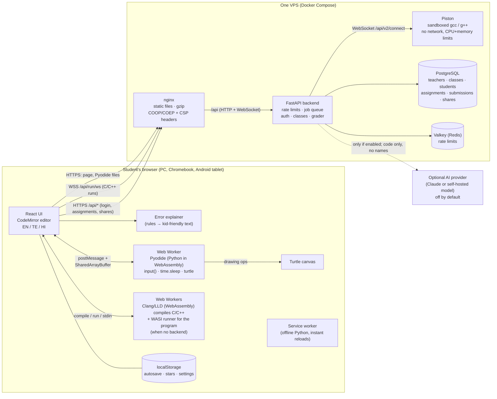

# Architecture



## How a run works

**Python** never touches the server. The editor sends the code to a Web Worker running
Pyodide. When the program calls `input()`, the worker posts "waiting for input" to the page
and blocks on `Atomics.wait` over a `SharedArrayBuffer`; the page shows an input box inside the
output screen and writes the typed line into the shared buffer. **Stop** sets Pyodide's
interrupt buffer (raises `KeyboardInterrupt`) and, if Python is stuck in native code, the worker
is thrown away and restarted. `turtle` is our own module that sends drawing operations to a
canvas, which animates them at the turtle's speed.

**C/C++ without a backend** (static or Node.js web hosting): `AutoCRunner` asks `/api/config`;
if no backend answers it uses `BrowserCRunner`. A compiler worker loads Clang/LLD built for
WebAssembly from `/clang/` (self-hosted; ~27 MB pre-compressed `.kgz` files, decompressed in the
browser, cached by the service worker), compiles `main.c`/`main.cpp` + the unbuffering runtime to
a WASI program, and a fresh program worker runs it with a small WASI implementation
(`runners/clang/program.worker.ts`: stdout/stderr, blocking stdin over SharedArrayBuffer, clocks,
random, sleep). Stop and the 5 s run limit terminate that worker. Memory is capped at 128 MB by the
linker. Clang's messages use the same `file:line:col: error:` format, and the explainer has rules
for both gcc and clang wording. `kalam-config.json` can force `"cRunner": "server" | "browser"`.

**C/C++ with a backend** opens a WebSocket to `/api/run/ws`:

```
browser → {type:"run", language:"c", code, client_id}
server  → status: loading → compiling → running
server  → stdout / stderr chunks           (streamed)
server  → input-request                    (program is blocked reading stdin)
browser → {type:"stdin", data:"21\n"}
browser → {type:"stop"}                    (optional)
server  → done {ok, error?, warnings?, timeMs}
```

The backend checks rate limits (1 run / 2 s per student, per-IP cap), waits for a free slot
(max 8 concurrent, short queue), then hands the program to the executor. Every C/C++ program
is linked with a 4-line runtime that makes `stdout` unbuffered, so a `printf("Age? ")` prompt
appears *before* the program waits — essential for kids.

**Errors**: the server returns the raw compiler/interpreter output plus a structured error
(`kind`, `type`, `line`). The browser's rule engine (`frontend/src/explainer/explain.ts`,
105 rules) picks a message id; the text comes from the i18n files, so explanations are
translated like the rest of the UI.

**Assignments**: "Check my work" sends the code to the backend, which runs it once per test
with the test input as stdin (Python prompts are hidden during grading), compares
normalised output, stores the submission and returns ✅/❌ per test. Secret tests never reveal
their input or expected output to students.

## Folder structure

```
kalam-compiler/
├── docker-compose.yml          # production: web + backend + piston + postgres + valkey
├── docker-compose.local.yml    # alternative: no Piston, local sandbox in the backend container
├── .env.example                # all settings, no secrets committed
├── LICENSES.md                 # generated from package metadata
├── frontend/
│   ├── Dockerfile, nginx.conf, nginx-headers.conf
│   ├── public/                 # favicon, manifest, sw.js (pyodide/ is copied in at install)
│   ├── scripts/copy-pyodide.mjs
│   ├── e2e/                    # Playwright: hello world ×3, input, errors, classroom, share
│   └── src/
│       ├── components/         # Home, EditorScreen, OutputPanel, TurtleCanvas, ErrorCard,
│       │                       # Login, Student/Teacher screens, Badges, Share…
│       ├── runners/            # Runner interface; pythonRunner + python/worker, serverRunner
│       ├── explainer/          # rule engine + 88 unit tests
│       ├── examples/           # python.ts, c.ts, cpp.ts (20 / 18 / 18 examples)
│       ├── i18n/locales/       # en.json, te.json, hi.json
│       └── lib/                # settings, storage, progress/badges, api, auth, router
├── backend/
│   ├── Dockerfile
│   ├── config/limits.yaml      # admin-tunable limits
│   ├── app/
│   │   ├── main.py, config.py, db.py, models.py, security.py, ratelimit.py
│   │   ├── runs.py             # WebSocket run endpoint, slots/queue, stats
│   │   ├── grader.py           # assignment auto-check
│   │   ├── executors/          # base.py, piston.py, local.py (+ kalam_shim/turtle.py)
│   │   ├── routers/            # auth, classes, assignments, misc (shares/progress/admin), ai
│   │   └── tools/piston_setup.py
│   └── tests/                  # 18 sandbox tests + 19 API tests
├── runner/README.md            # Piston configuration and hardening
├── scripts/                    # setup.sh, dev.sh, test.sh, licenses.py
└── docs/
```

## Data stored

| Where | What |
|---|---|
| Browser (localStorage) | code per language, settings, stars/badges, a random anonymous id for rate limiting |
| PostgreSQL | teachers (name, email, password hash), classes, students (**first name + PIN hash only**), assignments, submissions (code + results), shared programs |
| Valkey | rate-limit counters only (expire automatically) |
| Nowhere | IP addresses, analytics, tracking cookies |
